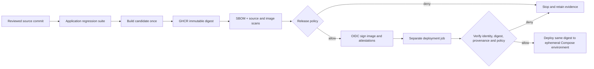

# VerifiedRelease for TenantLedger

A demonstrable software supply-chain security project built around a real multi-tenant
application. A successful build alone cannot authorize deployment: the deployer verifies
the image digest, build identity, source commit, signed SBOM, signed provenance and a
fresh security assessment before starting the same immutable artifact.

## What makes this a stronger portfolio project

The project connects application authorization security to artifact authorization.
It includes a real rejection lab, machine-readable decisions, remediation evidence,
and an exception lifecycle—not just scanner screenshots or a collection of tools.

| Requirement | Implementation | Reviewable evidence |
| --- | --- | --- |
| Container packaging | Multi-stage build, digest-pinned Python base, hash-locked dependencies, UID 10001, health check | `Dockerfile`, build log, container configuration report |
| Focused SAST | Bandit on application and migrations; medium+ blocks | `bandit.json` |
| Dependency audit | pip-audit against exact runtime lock; every advisory blocks | `dependencies.json` |
| Secret checks | Gitleaks across full Git history and source snapshot; redacted reports | `secrets*.json` |
| Container checks | Grype OS/application packages plus runtime user, command and health check | `container.json`, `container-config.json` |
| SBOM | Syft SPDX JSON of the exact registry digest, signed with Cosign | `sbom.spdx.json`, registry attestation |
| Provenance | SLSA v1 predicate describing source, builder and invocation, signed with Cosign | `provenance.json`, registry attestation |
| Admission | Exact OIDC identity + issuer + source SHA, subject digest, fresh scans, current policy | `decision.json` |
| Rejections | Real registry images and real Cosign verification, plus adversarial policy tests | `rejection-demo/report.json` |
| Exceptions | Specific finding/package/version/digest, owner, reason, reviewer, ticket and ≤14-day expiry | `security/exceptions.json` |

## Architecture

`release.yml` runs manually on `main` only and only in the intended repository. It
reuses the existing application CI. A candidate may be present in GHCR before checks
finish, but presence or a tag never grants deployment permission. Only a passing
candidate receives the release signature and three attestations.

The deployment job has read-only registry access and no OIDC signing permission.
It invokes the verifier itself rather than trusting the earlier job's “passed” status.
Both migration and API services use the verified digest with `--no-build`. Existing
PostgreSQL and Keycloak containers provide an ephemeral demonstration environment;
this is not a production database/identity deployment.

## Trust and policy

Trust roots are checked-in policy plus the verifier/Cosign installation, GitHub's
OIDC issuer, Sigstore's trust root/transparency log, and the reviewed workflow.
The certificate identity is the **exact** release workflow URL at `refs/heads/main`.
The expected commit comes from the workflow run, never from an image label or the
attestation being checked. The provenance must repeat that source, ref and commit.
All attestation subjects must name the expected repository and SHA-256 digest.
The signed SBOM must also match the canonical SBOM hash in the signed security assessment.

Default blocking rules:

- Medium/high SAST findings, all known Python dependency advisories, and every secret finding.
- High/critical/unknown-severity container vulnerabilities, whether or not a fix exists.
- Missing/failed scanners, malformed evidence, reports older than 24 hours, vulnerability databases older than 72 hours, or timestamps over five minutes in the future.
- Root runtime, absent health check or unexpected default command.
- Missing/wrong signatures, provenance, signed SBOM, source commit or artifact digest.
- Expired or malformed exceptions. There are **no active exceptions** by default.

Low/medium container findings remain in the signed report even when policy permits
them. A clean scan means no findings from the selected scanners/database at that time,
not a proof that the application has no vulnerabilities. Vendored frontend libraries
are not comprehensively covered by the Python audit; maintain their inventory and
review them separately. The intentional authorization mutation lab is outside SAST's
focused application scope.

## Security boundaries and limitations

- This is workflow-generated, signed SLSA v1 **format** provenance. It does not claim
  SLSA Level 3, independent reproducibility, or an isolated trusted builder. A compromised
  release workflow/runner can make false claims under its own legitimate identity.
- The gate enforces deployment through `deploy.py` and the supplied workflow. A host
  administrator can bypass it by running Docker directly. Kubernetes admission control
  with independently managed policy is an appropriate next iteration.
- Protect `main`, workflow files, policy, exceptions and toolchain pins with repository
  rulesets and code-owner review. `CODEOWNERS` records ownership; it does not enable
  those settings. A solo project cannot honestly claim independent approvals until a
  second reviewer participates.
- Tool binaries are version- and SHA-256-pinned. Initial pins were obtained from
  upstream release checksum manifests; this does not independently prove upstream
  publisher integrity. Pin review and upstream signature verification are maintenance duties.
- The signed SBOM and evidence describe one immutable artifact. Rebuild/re-attest for
  changed dependencies or expired evidence; do not extend an old scan's timestamp.
- Local demo keys cannot be used by the production deployment CLI. Local rejection
  results establish real signature/policy behavior, not a successful GitHub OIDC run.

## Read next

- [Setup and runbook](runbook.md)
- [Rejection demonstration](demo.md)
- [Exception process](exceptions.md)
- [Verification record](verification.md)

Technical references: [Cosign verification](https://docs.sigstore.dev/cosign/verifying/verify/),
[SLSA v1 provenance](https://slsa.dev/provenance/v1),
[Syft](https://github.com/anchore/syft), [Grype](https://github.com/anchore/grype).
